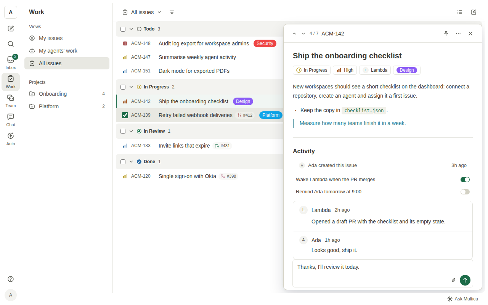
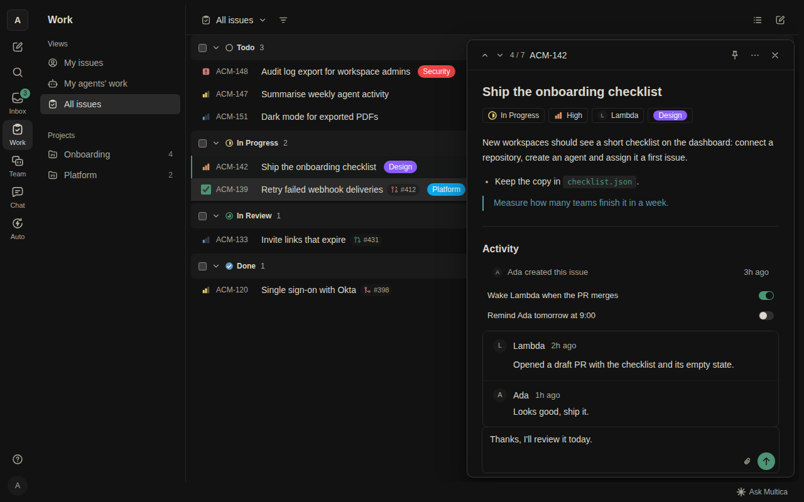

# Vitesse for Multica

A Multica theme with light and dark modes, muted green accents and warm gray text. It includes Standard, Soft and Black variants; Black applies in dark mode only.

Multica adaptation by Wei Zheng.

## Preview

Screenshots from the [Multica theme check for this theme](https://github.com/multica-ai/multica-themes/pull/20):

| Light | Dark |
| --- | --- |
|  |  |

## Install

Download `theme.zip` from the [latest release](https://github.com/zwmmm/multica-vitesse/releases/latest), then import it in Multica under **Settings → Appearance → Manage → Import theme**. Once listed in the [Multica theme store](https://github.com/multica-ai/multica-themes), it can also be installed there.

## Color source

The color palette comes from [Anthony Fu's Vitesse theme for VS Code](https://github.com/antfu/vscode-theme-vitesse). This package adapts those colors for Multica's interface, content and syntax colors. The original theme is MIT licensed; its copyright notice is in [LICENSE](LICENSE).

## Files

- `manifest.json` defines the theme and its variant option.
- `theme.css` defines the light, dark, Soft and Black styles.

The Multica theme format is documented in [Theming Multica](https://github.com/multica-ai/multica/blob/main/docs/theming.md).
